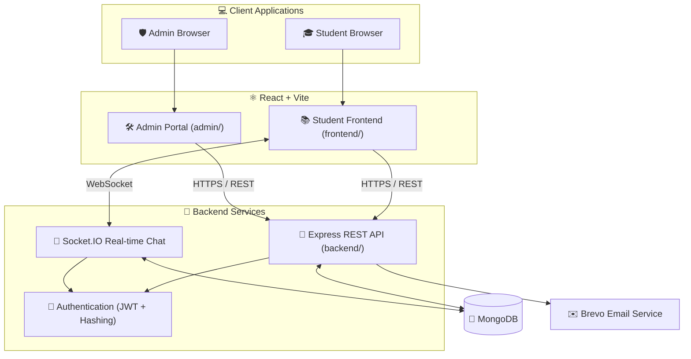

<div align="center">

# ⚡ SRM NOTE FINDER

### 🎓 Your Semester. Your Resources. One Smart Platform.

**A modern academic resource platform for discovering notes, organizing study materials, tracking grades, and connecting students.**

[](https://srm-note-finder.vercel.app)


**📚 Academic Resources** • **🧮 GPA Tools** • **💬 Student Chat** • **🛠️ Admin Portal**

</div>

---

## 🌌 About the Project

**SRM Note Finder** is a full-stack student-focused web application designed to bring academic resources and useful student tools into one convenient platform.

Browse semesters and subjects, organize unit-wise study materials, access previous-year question papers, calculate SGPA/CGPA grades, and use integrated real-time student communication features—all through a modern interface.

> 🎯 **Mission:** Spend less time searching for study materials and more time learning.

---

## ✨ Feature Highlights

| Academic & Student Features | Platform & Admin Features |
| :--- | :--- |
| **📚 Academic Resource Hub**<br>• Semester-wise and subject-wise organization<br>• Unit-wise study material navigation<br>• Previous-year question paper (PYQ) links | **🔐 Student Authentication**<br>• Student registration and login<br>• Email verification integration<br>• JWT token-based authentication & hashing |
| **🧮 GPA & Academic Tools**<br>• SGPA calculation<br>• CGPA calculation<br>• Grade-point based result entry | **💬 Student Communication**<br>• Real-time community chat with Socket.IO<br>• Private messaging & moderation controls |
| **🎨 Modern Experience**<br>• Multiple visual themes & responsive layout<br>• Separate student and admin experiences | **🛠️ Admin Portal**<br>• Separate administration frontend (`admin/`)<br>• Resource, subject, unit, and PYQ management |

---

## 🧭 Architecture at a Glance



---

## 🧰 Tech Stack

| Layer | Technology | Purpose |
| :--- | :--- | :--- |
| Student Frontend | React + Vite | Student-facing web application |
| Admin Frontend | React + Vite | Administration interface |
| Backend | Node.js + Express | REST API and server-side logic |
| Database | MongoDB + Mongoose | Persistent application data |
| Real-time | Socket.IO | Live community & private chat |
| Authentication | JWT + bcrypt | Token-based sessions and password hashing |
| Email | Brevo SMTP | Verification email delivery |
| Hosting | Vercel / Render / MongoDB Atlas | Production deployment |

---

## 📂 Project Structure

```text
srm-note-finder/
├── frontend/          # Student React + Vite application
├── admin/             # Separate admin React + Vite application
├── backend/           # Express API, Mongoose models, routes & Socket.IO server
├── render.yaml        # Render deployment configuration
└── README.md
```

---

## 🚀 Getting Started

### 1. Backend (`backend/`)

```bash
cd backend
npm install
# Configure PORT, MONGODB_URI, JWT_SECRET in .env
npm run dev
```

### 2. Student Frontend (`frontend/`)

```bash
cd frontend
npm install
# Configure VITE_API_URL in .env
npm run dev
```

### 3. Admin Portal (`admin/`)

```bash
cd admin
npm install
npm run dev
```

---

## 👤 Author

**S.S. Manikanda Prabu** (`@SSManikandaprabu`)  
- 🌐 Live Demo: [srm-note-finder.vercel.app](https://srm-note-finder.vercel.app)
- 🛠 GitHub: [SSManikandaprabu](https://github.com/SSManikandaprabu)
