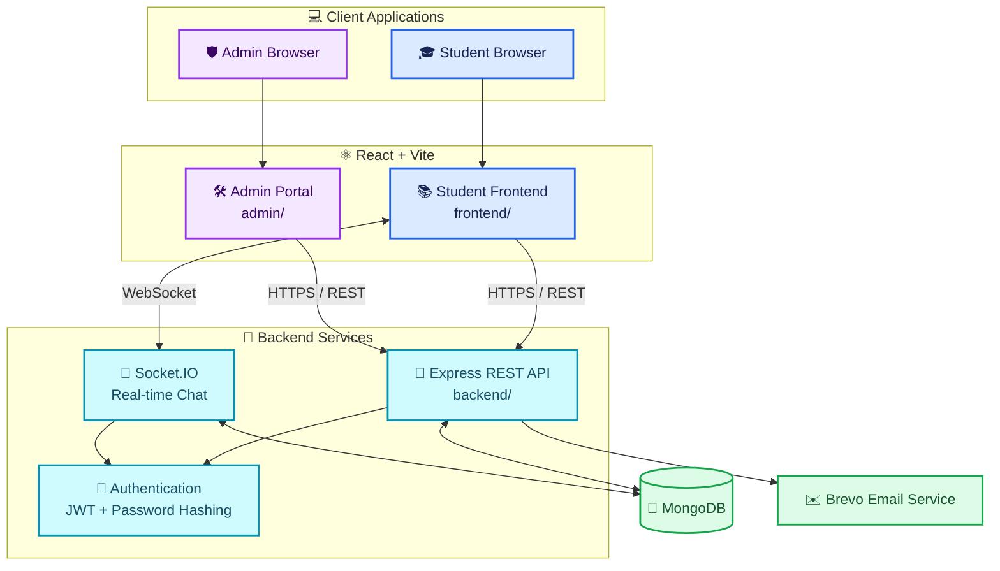

[README (3).md](https://github.com/user-attachments/files/33659160/README.3.md)
::: {align="center"}
# ⚡ SRM NOTE FINDER

### 🎓 Your Semester. Your Resources. One Smart Platform.

**A modern academic resource platform for discovering notes, organizing
study materials, tracking grades, and connecting students.**

```{=html}
<p>
```
``{=html}
``{=html}
``{=html}
``{=html}
``{=html}
```{=html}
</p>
```
```{=html}
<p>
```
`<b>`{=html}📚 Academic Resources`</b>`{=html}  •  `<b>`{=html}🧮 GPA
Tools`</b>`{=html}  •  `<b>`{=html}💬 Student Chat`</b>`{=html}  • 
`<b>`{=html}🛠️ Admin Portal`</b>`{=html}
```{=html}
</p>
```
:::

------------------------------------------------------------------------

## 🌌 About the Project

**SRM Note Finder** is a full-stack student-focused web application
designed to bring academic resources and useful student tools into one
convenient platform.

Browse semesters and subjects, organize unit-wise study materials,
access previous-year question papers, calculate academic grades, and use
integrated student communication features---all through a modern
interface.

> 🎯 **Mission:** Spend less time searching for study materials and more
> time learning.

## ✨ Feature Highlights

```{=html}
<table>
```
```{=html}
<tr>
```
```{=html}
<td width="50%" valign="top">
```
### 📚 Academic Resource Hub

-   Semester-wise and subject-wise organization
-   Notes and study-material links
-   Unit-wise resource navigation
-   Previous-year question paper links
-   Centralized resource management

```{=html}
</td>
```
```{=html}
<td width="50%" valign="top">
```
### 🧮 GPA & Academic Tools

-   SGPA calculation
-   CGPA calculation
-   Grade-point based calculations
-   Simple academic result entry
-   Useful student productivity tools

```{=html}
</td>
```
```{=html}
</tr>
```
```{=html}
<tr>
```
```{=html}
<td width="50%" valign="top">
```
### 🔐 Student Authentication

-   Student registration and login
-   Email verification integration
-   Password hashing
-   Token-based authentication

```{=html}
</td>
```
```{=html}
<td width="50%" valign="top">
```
### 💬 Student Communication

-   Community chat interface
-   Real-time messaging with Socket.IO
-   Private messaging interface
-   Student and administrator workflows

```{=html}
</td>
```
```{=html}
</tr>
```
```{=html}
<tr>
```
```{=html}
<td width="50%" valign="top">
```
### 🛠️ Admin Portal

-   Separate administration frontend
-   Academic resource management
-   Subject and semester management
-   Unit links and PYQ links
-   Extendable moderation workflow

```{=html}
</td>
```
```{=html}
<td width="50%" valign="top">
```
### 🎨 Modern Experience

-   Multiple visual themes
-   Customizable backgrounds
-   Animated interface elements
-   Responsive layout
-   Separate student and admin experiences

```{=html}
</td>
```
```{=html}
</tr>
```
```{=html}
</table>
```
> **Implementation note:** Features should be described as
> production-ready only after their behavior has been verified. The
> feature list describes the project's intended/current areas; use the
> testing section and roadmap to track actual completion.

------------------------------------------------------------------------

## 🧭 Architecture at a Glance



### 🔄 Request flow

1.  A student or administrator opens the appropriate React frontend.
2.  The frontend calls the backend API for supported operations.
3.  The backend validates requests and enforces
    authentication/authorization where implemented.
4.  MongoDB stores application data.
5.  Socket.IO supports real-time chat communication.
6.  Brevo handles email delivery for configured verification workflows.

**Security principle:** A hidden button or separate admin URL is not
authorization. Protected operations must be checked by the backend.

------------------------------------------------------------------------

## 🧰 Tech Stack

  -----------------------------------------------------------------------
  Layer                   Technology              Purpose
  ----------------------- ----------------------- -----------------------
  Student frontend        React + Vite            Student-facing web
                                                  application

  Admin frontend          React + Vite            Administration
                                                  interface

  Styling                 CSS                     Layout, themes,
                                                  backgrounds, animations

  Backend                 Node.js + Express       API and server-side
                                                  logic

  Database                MongoDB + Mongoose      Persistent application
                                                  data

  Real-time               Socket.IO               Live chat communication

  Authentication          JWT + bcrypt            Token-based sessions
                                                  and password hashing

  Email                   Brevo SMTP integration  Email verification
                                                  delivery

  Hosting targets         Vercel / Render /       Proposed deployment
                          MongoDB Atlas           architecture
  -----------------------------------------------------------------------

*Confirm the exact installed dependencies and production hosting status
from the project configuration before publishing claims about
deployment.*

------------------------------------------------------------------------

## 📂 Project Structure

``` text
srm-notes/
├── frontend/                  # Student React + Vite application
│   └── src/
├── admin/                     # Separate admin React + Vite application
│   └── src/
├── backend/                   # Express API and backend services
│   ├── models/                # Mongoose models
│   ├── routes/                # API route handlers
│   └── server.js              # Backend entry point
├── .gitignore
└── README.md
```

This is a simplified overview. The repository may contain additional
components, styles, utilities, and configuration files.

------------------------------------------------------------------------

## 🚀 Getting Started

### 1. Prerequisites

Install:

-   [Node.js](https://nodejs.org/)
-   npm
-   [Git](https://git-scm.com/)
-   MongoDB or a configured MongoDB Atlas database

Email verification also requires the existing email-service
configuration.

### 2. Clone the repository

``` bash
git clone YOUR_REPOSITORY_URL
cd "srm notes"
```

Replace `YOUR_REPOSITORY_URL` with your actual repository URL.

### 3. Install dependencies

Run each command in its own terminal, or finish one directory before
moving to the next.

**Backend**

``` bash
cd backend
npm install
```

**Student frontend**

``` bash
cd frontend
npm install
```

**Admin frontend**

``` bash
cd admin
npm install
```

### 4. Configure environment variables

Check the backend source code and existing `.env` usage to confirm the
exact variable names. Typical examples may include:

``` env
PORT=5000
MONGODB_URI=your_mongodb_connection_string
JWT_SECRET=your_long_random_secret
```

For the student frontend, if the code uses `VITE_API_URL`:

``` env
VITE_API_URL=http://localhost:5000
```

Configure the admin frontend's API URL and the existing Brevo settings
as required by your code.

> 🔒 **Never commit secrets.** Keep `.env` files, database credentials,
> JWT secrets, SMTP passwords, verification codes, and tokens out of
> Git. Frontend variables prefixed with `VITE_` are exposed to browser
> code, so never put secrets in them.

### 5. Start the applications

Use the scripts actually defined in each directory's `package.json`.

**Backend**

``` bash
cd backend
npm run dev
```

If `dev` is not defined, use the existing start script.

**Student frontend**

``` bash
cd frontend
npm run dev
```

**Admin frontend**

``` bash
cd admin
npm run dev
```

Open the local URLs printed by Vite. Ports can differ if a default port
is already in use.

------------------------------------------------------------------------

## 🔐 Security & Privacy

Security is part of the project's design and ongoing verification.

Areas to implement and verify before production include:

-   Server-side student authentication and administrator authorization
-   Authenticated Socket.IO connections
-   Private-message ownership and conversation isolation
-   Input validation and safe message rendering
-   Rate limiting and spam protection
-   Abuse-word filtering and moderation controls
-   Temporary and permanent restrictions
-   Secure environment-variable handling
-   HTTPS and production CORS configuration
-   Appropriate database permissions and backups

**Do not assume a security feature works until it has been tested on the
backend.** Mark unfinished features in the roadmap rather than
presenting them as completed.

------------------------------------------------------------------------

## 🧪 Build & Test

Run the production build in each frontend directory:

``` bash
# Student frontend
cd frontend
npm run build
```

``` bash
# Admin frontend
cd admin
npm run build
```

Run backend tests using the scripts defined in `backend/package.json`.

### Suggested verification checklist

-   [ ] Student frontend builds successfully
-   [ ] Admin frontend builds successfully
-   [ ] Backend starts and connects to the intended database
-   [ ] Student registration and email verification work
-   [ ] Login and logout work
-   [ ] Protected endpoints reject invalid or expired tokens
-   [ ] Admin-only operations enforce backend authorization
-   [ ] Community Chat works with the intended authentication rules
-   [ ] Private messages cannot be accessed by unauthorized students
-   [ ] Resource links and GPA calculations behave correctly
-   [ ] Mobile layout, themes, and existing features remain functional
-   [ ] Production URLs and CORS are configured correctly

A successful build does not prove every feature or security control
works. Record actual test results before marking items complete.

------------------------------------------------------------------------

## ☁️ Deployment Architecture

  Component                 Suggested platform
  ------------------------- ------------------------------------------------
  Student frontend          [Vercel](https://vercel.com/)
  Admin frontend            [Vercel](https://vercel.com/)
  Express API + Socket.IO   [Render](https://render.com/)
  Database                  [MongoDB Atlas](https://www.mongodb.com/atlas)
  Email verification        [Brevo](https://www.brevo.com/)

These are suggested hosting targets, not confirmation that the project
is already deployed.

Before launch:

1.  Configure production environment variables on the hosting platforms.
2.  Use the actual deployed API and Socket.IO URLs.
3.  Configure CORS for the exact frontend domains.
4.  Keep database and email credentials on the backend.
5.  Test authentication, private-message privacy, and email delivery.
6.  Check logs and deployment health without exposing secrets.

------------------------------------------------------------------------

## 🗺️ Roadmap

Update this checklist to reflect the real state of the repository.

-   [x] Student website foundation
-   [x] Separate admin frontend foundation
-   [x] Academic resource organization
-   [x] GPA calculator interface
-   [x] Student authentication flow
-   [x] Community Chat interface
-   [x] Private messaging interface
-   [ ] Verify backend authentication for both chat systems
-   [ ] Verify private-message authorization and seven-day expiry
-   [ ] Complete and test blocking and unblocking
-   [ ] Complete and test abuse-word filtering and spam controls
-   [ ] Complete admin moderation and reporting workflows
-   [ ] Finish security and regression testing
-   [ ] Deploy and verify production services

------------------------------------------------------------------------

## 🤝 Contributing

Suggestions and contributions are welcome.

1.  Fork the repository.
2.  Create a feature branch.
3.  Make a focused change.
4.  Test your changes.
5.  Open a pull request with a clear summary and test results.

Do not commit secrets, personal student information, private messages,
or verification codes.

## 📸 Screenshots

Add screenshots from the actual running application to make the
repository more useful to visitors.

Suggested folder:

``` text
docs/
└── screenshots/
    ├── home.png
    ├── resources.png
    ├── gpa-calculator.png
    └── admin-dashboard.png
```

Then embed them using relative paths, for example:

``` markdown

```

## 📄 License

No license is specified here. Add a `LICENSE` file only after choosing
the license you want to use.

------------------------------------------------------------------------

::: {align="center"}
### 💙 Built for smarter student workflows.

**SRM Note Finder** · *Find resources. Focus on learning. Stay
connected.*
:::
